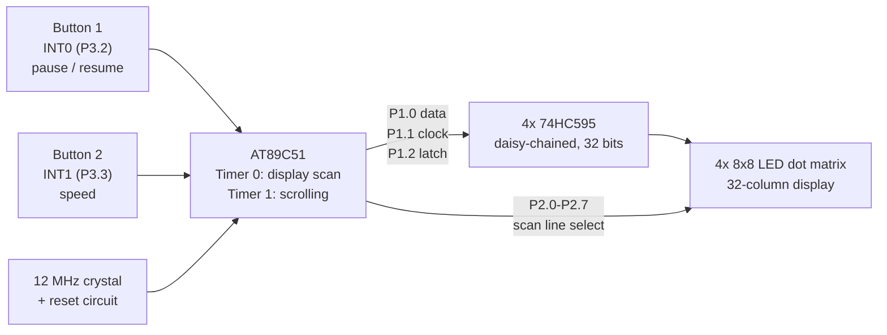

# 8051 Scrolling LED Matrix Message Board

A scrolling text display built on an AT89C51 (8051) microcontroller, driving four 8x8 LED dot matrices through cascaded 74HC595 shift registers. Designed and simulated in Proteus, firmware written in embedded C with Keil uVision.

> **Course project:** EE3008 Microprocessors, Antalya Bilim University, Spring 2026.

<!-- TODO: add a screenshot or short GIF of the Proteus simulation here (demo.gif) -->

## What it does

- Scrolls the message `WELCOME TO ANTALYA BILIM UNIVERSITY SPRING 2026` across a 32-column display (4 matrices x 8 columns) and loops forever.
- **Button on INT0:** pause / resume scrolling.
- **Button on INT1:** cycle through three scroll speeds (slow / medium / fast).

## Hardware (simulated in Proteus)

| Part | Role |
|---|---|
| AT89C51 | Microcontroller, 12 MHz crystal, RC reset |
| 4x 8x8 LED dot matrix | Display, placed side by side |
| 4x 74HC595 (daisy-chained) | Serial-to-parallel drivers, 3 MCU pins for 32 bits |
| 2 push buttons | External interrupts INT0 (P3.2) and INT1 (P3.3) |

Pin map: `P1.0` serial data, `P1.1` shift clock, `P1.2` latch, `P2` line select.

### System overview



<!-- TODO: add the Proteus schematic screenshot (docs/images/schematic.png) -->
<!-- TODO: double-check the wording "row"/"column" for P2 and the 595 outputs against your own schematic -->

## How the firmware works

Everything runs from interrupts; `main()` only sets them up and then idles.

| Module | What it does |
|---|---|
| Font table | Hand-made 8x8 glyphs stored in code memory (only the characters used in the message) |
| Timer 0 (~1 ms) | Display scanning: pushes the buffer bytes to the shift registers, latches, enables the next line on P2 |
| Timer 1 (50 ms tick) | Scrolling: shifts the 32-byte display buffer by one position and feeds in the next column of the current character |
| INT0 / INT1 | Pause toggle and speed change (`scrollLimit` = 20 / 10 / 3 ticks) |

## Repository layout

```
project/      Keil uVision project (main.c, startup file), compiled .hex in Objects/,
              and the Proteus schematic. Kept together because Proteus loads the
              .hex from the relative path Objects\8051_Led_Board.hex.
```

## How to run

1. Open `project/Scrolling_Message_Board.pdsprj` in Proteus (Windows).
2. Run the simulation. The AT89C51 loads `project/Objects/8051_Led_Board.hex` automatically.

To rebuild the firmware, open `project/8051_Led_Board.uvproj` in Keil uVision (Windows).

## Challenges

**Wiring in Proteus.** The schematic needs many connections (four matrices, four daisy-chained shift registers, two buttons, crystal and reset). Getting every wire right took a lot of effort at the start and was the hardest part of the build.

**Getting the text orientation right.** Once the hardware worked, the text appeared mirrored or upside down. It took a long time to track down and fix before the orientation was correct. The font table only covers the characters used in the message; any other character is drawn as a blank.

<!-- TODO (after checking on Windows): add exactly what was changed to fix the orientation -->

## What I learned

- **Interrupt-driven design.** Timer 0 refreshes one scan line about every millisecond, Timer 1 drives the scrolling with a 50 ms tick, and two external interrupts handle the buttons. `main()` is just an empty loop. Running several time-based tasks at different rates this way is something I could not have done cleanly with `delay` loops.
- **Multiplexing and shift registers.** Lighting one line at a time, fast enough that the eye sees a full picture, keeps the pin count low. Cascading four 74HC595 shift registers lets the microcontroller drive 32 outputs with only three pins (data, clock, latch).
- **Hardware and software both had to be right.** First I had to get the wiring in the Proteus schematic correct, and only then could I work on the text orientation in the code.
- **Keep notes while debugging.** Fixing the orientation took a lot of trial and error, and I did not write down what I changed. Since then I commit small steps and keep a project log, so I can always trace how a problem was solved.
